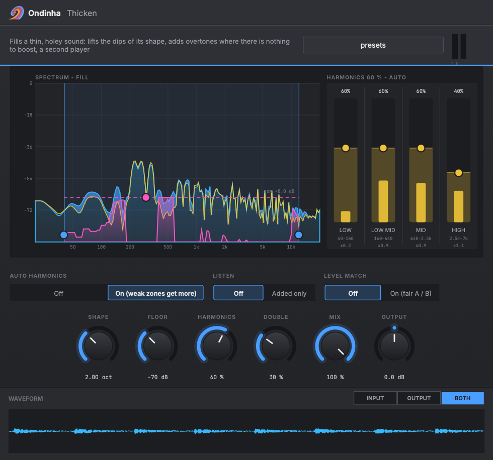

# Ondinha Thicken

**Makes a thin, holey sound full. Lifts the dips in its tone, adds overtones where an EQ has nothing to boost, and plays a second player under it. Mastering-grade, alias-free, transparent at zero.**

A VST3 and Audio Unit plug-in from [Ondinha](https://github.com/ondinha), a DAW 2.0: native AI tools combined with traditional sound engineering tools.



Cheap synths, small DI guitars, thin drum samples and lo-fi mixes sound hollow for two reasons. Their tone has dips, and whole regions have nothing in them. An EQ only helps with the first one: you can't boost what isn't there. Thicken handles both.

- **Fill** finds the regions that sit under the sound's own broad shape and lifts them toward it, up to the amount you set. It works on the music, not on a fixed curve: when the hole moves, the lift moves with it. Silence and hiss under the floor are left alone.
- **Harmonics** creates new overtones from four bands, so a region with nothing in it gets something that belongs to the note. With **Auto**, a band whose overtones land in a weak region gets more, and one landing in a busy region gets fewer.
- **Double** adds a second player: a short, slightly detuned copy (+-7 cents) with its lows kept out, so the bass stays tight.

Everything is added on top of the untouched signal. With Fill, Harmonics and Double at zero, the output is the input, bit for bit.

## What it's good for

- **Thin synths and samples:** the classic "sounds cheap" fix. Body under the notes, weight in the low mids, life in the highs.
- **DI and amp-sim guitars:** fills the holes a cheap cab leaves without the mud a low-mid boost brings.
- **Drum samples:** a small snare or kick gets the overtones of a bigger one.
- **Mix bus and masters:** small amounts with **Level match** on. The mix gets denser and fuller, and you judge it at the same loudness.

## The window

- **Spectrum - fill:** before (yellow) and after (blue), with the live lift in pink. Drag the dashed ceiling to set Fill, and the band edges (or the band itself) to set where it works. Hover a harmonic band to see where its overtones land.
- **Harmonics:** one column per band (low, low mid, mid, high). Drag it up for more. The bright core shows what plays now (the column x Harmonics x the auto factor).
- **Waveform:** the input and output over the last seconds.

A handle shows its value while you drag. Double-click resets, alt gives fine control, and every drag is one undo step and one automation gesture in your DAW.

## Controls

| Control | Range | What it does |
|---|---|---|
| Fill | 0 to 12 dB | How far the dips are lifted toward the broad shape |
| Focus low / high | 20 Hz to 20 kHz | Where Fill works |
| Shape | 1 to 4 octaves | How broad the shape the dips are measured against is |
| Floor | -90 to -30 dBFS | Nothing quieter than this is lifted |
| Harmonics | 0 to 100 % | Overall amount of new overtones |
| Low / Low mid / Mid / High | 0 to 100 % | Overtones from 40-160 Hz, 160-640 Hz, 640 Hz-2.5 kHz, 2.5-7 kHz |
| Auto harmonics | Off / On | Weak landing zones get more, busy ones fewer |
| Double | 0 to 100 % | The second player |
| Mix | 0 to 100 % | How much of what is added you hear |
| Output | +-12 dB | Output level |
| Level match | Off / On | The output follows the input's loudness (3 s), for a fair A / B |
| Listen | Off / Added only | Hear just what Thicken adds |

## Presets

Built in as host programs (your DAW's preset menu). Inside Ondinha you can also save your own.

- Thin synth
- Cheap DI guitar
- Small drum sample
- Bus glue
- Gentle master
- Master: thin mix

## Download and install

**[Download the latest release](https://github.com/ondinha/ondinha-thicken/releases/latest)** (macOS, Windows, Linux) or get it from the [product page](https://ondinha.app/plugins/thicken).

**macOS:** copy `Ondinha Thicken.vst3` to `~/Library/Audio/Plug-Ins/VST3` and `Ondinha Thicken.component` to `~/Library/Audio/Plug-Ins/Components`. The plug-ins aren't notarized yet, so clear the download flag once:

```sh
xattr -dr com.apple.quarantine ~/Library/Audio/Plug-Ins/VST3/"Ondinha Thicken.vst3" ~/Library/Audio/Plug-Ins/Components/"Ondinha Thicken.component"
```

Then rescan plug-ins in your DAW.

**Windows:** copy the `Ondinha Thicken.vst3` folder to `C:\Program Files\Common Files\VST3`, then rescan.

**Linux:** copy the `Ondinha Thicken.vst3` folder to `~/.vst3`, then rescan.

| Format | Platform |
|---|---|
| VST3 | macOS (Apple Silicon + Intel), Windows 10+ (64-bit), Linux (x64) |
| Audio Unit (AU) | macOS |

Works in any VST3 or AU host: Ableton Live, Logic Pro, Reaper, Bitwig Studio, Cubase, Studio One, FL Studio and others.

## How it works

**Fill** is a dynamic EQ on a short-time Fourier transform (4096 points at 44.1 / 48 kHz, so 11.7 Hz bins; 75 % overlap; sqrt-Hann windows; zero-phase gains). Each frame measures the 1/3-octave band level around every bin and compares it with the sound's broad shape: the dB mean over `Shape` octaves on a log-frequency scale, so a pink tilt reads as flat and nothing is lifted just for falling with frequency. Regions under the shape are lifted toward it, at most `Fill` dB and never under the floor. The lift rises in 30 ms and falls back in 250 ms, smooth across frequency and time, so it doesn't warble. Only the difference is synthesised and added to the dry signal, so where nothing is lifted, nothing changes.

**Harmonics** splits the signal into four bands with 24 dB/oct Butterworth filters (48 dB/oct at the top of the high band). Each band is normalised by a smooth RMS envelope, shared by both channels so the stereo image of what is added follows the source. It is then shaped by Chebyshev polynomials (T2 for the 2nd harmonic, T3 for the 3rd), behind a soft limit so transients stay clean. The overtones and their intermodulation follow the band's level, so quiet stays quiet. They are band-limited again before mixing in. The whole path runs at 2x through a linear-phase half-band FIR. It reads its input ahead in the analysis buffer by the oversampler's latency, so the overtones line up with the dry sample for sample at no extra latency. Measured: a 9 kHz tone's 3rd overtone folds back at -127 dB.

**Double** is a 16 ms delay with 4-point Hermite interpolation, modulated at 0.35 Hz for +-7 cents (left and right in quadrature), high-passed at 150 Hz.

Latency is one analysis frame (about 85 ms at 48 kHz), reported to the host. CPU is about 2 % of one core at 48 kHz.

## More Ondinha plug-ins

- [Ondinha Split EQ](https://github.com/ondinha/ondinha-split-eq): Transient / tonal split EQ: separate gain for the attack and the sustain in every band.
- [Ondinha Tube Air](https://github.com/ondinha/ondinha-tube-air): High-frequency exciter with a tube stage: adds warm even or bright odd harmonics above a frequency, under the untouched signal.
- [Ondinha Resonance](https://github.com/ondinha/ondinha-resonance): Dynamic resonance tamer for harsh mixes, vocals and guitars: pulls down narrow peaks only while they ring and leaves the broad tone alone.
- [Ondinha Bus Comp](https://github.com/ondinha/ondinha-bus-comp): Console-style glue compressor for the mix bus and groups.
- [Ondinha Limiter](https://github.com/ondinha/ondinha-limiter): True-peak brickwall limiter for mastering, with an optional oversampled clipper.
- [Ondinha Unmask](https://github.com/ondinha/ondinha-unmask): Spectral side-chain ducking: dips a track only at the frequencies where the key is loud, only while it plays.
- [Ondinha Imager](https://github.com/ondinha/ondinha-imager): Multiband stereo imager with mono low end: width for lows, mids and highs on phase-matched Linkwitz-Riley crossovers.
- [Ondinha Delay](https://github.com/ondinha/ondinha-delay): Tempo-synced stereo / ping-pong delay with filtered, saturated feedback and ducking, so the echoes stay out of the way of the vocal.
- [Ondinha Graphic EQ](https://github.com/ondinha/ondinha-graphic-eq): 10-band octave graphic EQ with analog-matched bells (31 Hz - 16 kHz, +-12 dB).

## Feedback

Found a bug or a host where it misbehaves? [Open an issue](../../issues) with your DAW, its version and your OS.
